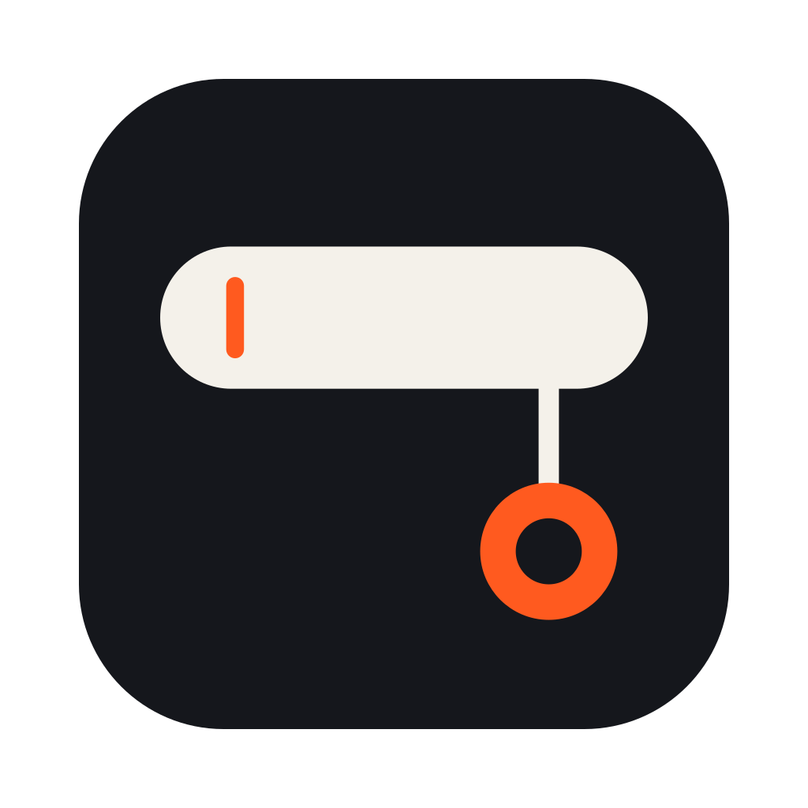

<div align="center">
    
    <h1>Ripcord</h1>
    <p><a href="./README.md">English</a> / 日本語</p>
</div>

> Apple silicon の Mac で常駐する小さなランチャー。Swift と AppKit で書いています。

⌘Space でパネルが開きます。入力してアプリを開いたり、計算（`1+2*3`）したり、次の機能を使ったりできます。多くは Raycast と同じ操作で動きます。

<table>
  <tr>
    <td></td>
    <td><b>Applications</b></td>
    <td>アプリを日本語名でも英語名でも開く。エイリアスとホットキーも付けられる。</td>
  </tr>
  <tr>
    <td></td>
    <td><b>Quicklinks</b></td>
    <td><code>g swift</code> のようにキーワードで検索やリンクを開く。</td>
  </tr>
  <tr>
    <td></td>
    <td><b>Clipboard History</b></td>
    <td>コピーしたテキスト・画像・ファイルを検索して貼り付ける。</td>
  </tr>
  <tr>
    <td></td>
    <td><b>Snippets</b></td>
    <td>保存したテキストを貼り付ける。キーワードの入力でも展開する。</td>
  </tr>
  <tr>
    <td></td>
    <td><b>System Actions</b></td>
    <td>ロック、スリープ、音楽と音量の操作、アプリの終了。</td>
  </tr>
  <tr>
    <td></td>
    <td><b>Window Management</b></td>
    <td>最前面のウインドウを半分・4分の1・3分の1に配置する。</td>
  </tr>
  <tr>
    <td></td>
    <td><b>Coffee</b></td>
    <td>Mac をスリープさせずにおく。時間も指定できる。</td>
  </tr>
  <tr>
    <td></td>
    <td><b>Sleep Timer</b></td>
    <td>時間が来たら Mac をスリープするか画面を消す。</td>
  </tr>
  <tr>
    <td></td>
    <td><b>Lid Awake</b></td>
    <td>蓋を閉じても、バッテリーでも Mac を起こしておく。</td>
  </tr>
  <tr>
    <td></td>
    <td><b>Color Picker</b></td>
    <td>画面のどこからでも色を拾い、好きな形式でコピーする。</td>
  </tr>
  <tr>
    <td></td>
    <td><b>Clean Keyboard</b></td>
    <td>拭き掃除のあいだキーボードを止めておく。</td>
  </tr>
  <tr>
    <td></td>
    <td><b>Bookmarks</b></td>
    <td>Markdown ファイルにリンクとして書いたブックマーク。</td>
  </tr>
  <tr>
    <td></td>
    <td><b>Notes</b></td>
    <td>小さなフローティングウインドウで書く Markdown のノート。</td>
  </tr>
  <tr>
    <td></td>
    <td><b>Lorem Ipsum Generator JP</b></td>
    <td>好きな長さの日本語・英語のダミーテキスト。</td>
  </tr>
  <tr>
    <td></td>
    <td><b>Script Commands</b></td>
    <td>Raycast の Script Commands を引数付きで実行する。</td>
  </tr>
  <tr>
    <td></td>
    <td><b>Emoji &amp; Symbols</b></td>
    <td>絵文字と記号を英語でも日本語でも検索する。</td>
  </tr>
  <tr>
    <td></td>
    <td><b>CleanShot X</b></td>
    <td>CleanShot X で撮影・録画・注釈をする。</td>
  </tr>
  <tr>
    <td></td>
    <td><b>Git Repositories</b></td>
    <td>フォルダ内の Git リポジトリを開く・clone する・削除する。</td>
  </tr>
  <tr>
    <td></td>
    <td><b>HTTP Status Codes</b></td>
    <td>HTTP ステータスコードを番号か名前で調べる。</td>
  </tr>
</table>

## はじめかた

まず ⌘Space を空けてください。Spotlight のショートカットを切り、ほかのランチャーの割り当ても外します。あとから Settings で別のホットキーにもできます。

1. [Releases](https://github.com/meltin/ripcord/releases) から `Ripcord-<version>.zip` をダウンロードして展開し、`Ripcord.app` を `/Applications` に移します。
2. Ripcord は自己署名の証明書で署名していて公証を受けていないため、初回の起動は macOS に止められます。`xattr -dr com.apple.quarantine /Applications/Ripcord.app` を実行するか、Control キーを押しながらアプリをクリックして「開く」を選んでください。

macOS 26 以降の Apple silicon の Mac で動きます。貼り付けとスニペットのキーワード展開にはアクセシビリティの許可が要り、最初の貼り付けで確認されます（[Permissions](./docs/permissions.md)）。

### アップデート

1 日に 1 回新しいリリースを確かめ、あればインストールを勧めます（[Sparkle](https://sparkle-project.org) を使います）。Check for Updates はメニューバーのメニュー、パネルの ⌘K、検索から使えます。毎日の確認は Settings › General で止められます。0.1.0 にはアップデーターがないため、その次のリリースは一度だけ手で入れてください。Nix で入れたものは Nix で更新します。

### Nix で入れる

```sh
nix profile add github:meltin/ripcord
# インストールせずに試す
nix build github:meltin/ripcord && open result/Applications/Ripcord.app
```

flake はホストの Xcode 26 以降でビルドします。SwiftUI の `@State` はマクロで、そのプラグインは Xcode にしか入っておらず、nixpkgs の Swift では展開できないためです。そのためビルドは Nix のサンドボックスの外で動きます。macOS の既定の `sandbox = false` か `relaxed` なら動きます。

## ソースからビルド

Xcode 26 以降が要ります。

```sh
scripts/build-app.sh
open build/Ripcord.app
swift test
```

## ドキュメント（英語）

- [Permissions](./docs/permissions.md): 貼り付けとキーワード展開に要るアクセシビリティの許可
- [Configuration](./docs/configuration.md): `~/.config/ripcord/config.json` の全項目
- [Command line](./docs/command-line.md): `ripcord` コマンドと MCP サーバー

## 既知の制限

macOS が用意していない手段で回避するより、そのままにしているものです。

- Notes: Ripcord Notes と、Raycast Notes のようにアプリを前に出さないほかのフローティングウインドウを両方開いていると、もう一方をクリックしてもキー入力が Ripcord Notes に残ることがあります（[#73](https://github.com/meltin/ripcord/issues/73)）。普通のアプリをクリックすれば移ります。
- Quicklinks: ホットキーで `{query}` に入る選択テキストは、アクセシビリティで選択範囲を伝えるアプリからだけ取れます。ほかのアプリでは空のままにします。⌘C でコピーするとクリップボードの中身を置き換えてしまうためです。
- System Actions: Raycast にある Dismiss Notifications はありません。macOS には通知センターをアプリから消す方法がなく、アクセシビリティでボタンを押すしかありませんが、macOS が変わると壊れるためです（[#30](https://github.com/meltin/ripcord/issues/30)）。

## ライセンス

Ripcord は [MIT](./LICENSE) ライセンスです。

パネルの操作に出る GitHub のアイコンは [it-icons](https://github.com/ouka-lab/it-icons) のもので、[MIT](./Resources/ThirdParty/GitHub-LICENSE.txt) です。絵文字の名前は Unicode の [CLDR](https://github.com/unicode-org/cldr-json) と [emoji-test.txt](https://unicode.org/Public/emoji/latest/emoji-test.txt) によるもので、[Unicode License](./Resources/ThirdParty/Unicode-LICENSE.txt) です。そのほかのアイコンは [Tabler Icons](https://github.com/tabler/tabler-icons) で、[MIT](./Resources/ThirdParty/Tabler-LICENSE.txt) です。Generate Dummy Text の単語リストは Raycast の [Japanese Lorem Ipsum Generator](https://github.com/raycast/extensions/tree/main/extensions/lipsum) によるもので、[MIT](./Resources/ThirdParty/Lipsum-LICENSE.txt) です。アップデートは [Sparkle](https://github.com/sparkle-project/Sparkle) を使っていて、[そのライセンス](./Resources/ThirdParty/Sparkle-LICENSE.txt) に従います。
