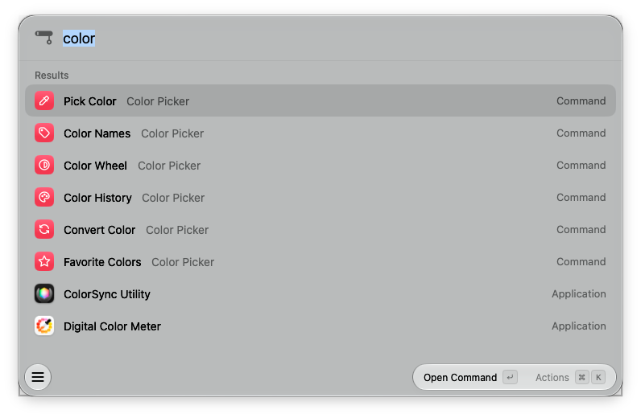

<div align="center">
    
    <h1>Ripcord</h1>
    <p>English / <a href="./README.ja.md">日本語</a></p>
</div>

> A small, resident launcher for Apple silicon Macs, written in Swift and AppKit.

<p align="center"></p>

⌘Space opens the panel. Type to open apps, calculate (`1+2*3`) or run one of these, many of
them made to work as Raycast's do:

<table>
  <tr>
    <td></td>
    <td><b>Applications</b></td>
    <td>Open apps by their localized or file name, with aliases and hotkeys.</td>
  </tr>
  <tr>
    <td></td>
    <td><b>Quicklinks</b></td>
    <td>Open a search or a link by keyword, as in <code>g swift</code>.</td>
  </tr>
  <tr>
    <td></td>
    <td><b>Clipboard History</b></td>
    <td>Text, images and files you copied, searchable and ready to paste.</td>
  </tr>
  <tr>
    <td></td>
    <td><b>Snippets</b></td>
    <td>Saved text to paste, or to expand from a keyword as you type.</td>
  </tr>
  <tr>
    <td></td>
    <td><b>System Actions</b></td>
    <td>Lock, sleep, control music and volume, and quit apps.</td>
  </tr>
  <tr>
    <td></td>
    <td><b>Window Management</b></td>
    <td>Put the frontmost window in a half, quarter or third.</td>
  </tr>
  <tr>
    <td></td>
    <td><b>Coffee</b></td>
    <td>Keep the Mac awake, for as long as you like.</td>
  </tr>
  <tr>
    <td></td>
    <td><b>Sleep Timer</b></td>
    <td>Sleep the Mac, or turn its display off, after a while.</td>
  </tr>
  <tr>
    <td></td>
    <td><b>Lid Awake</b></td>
    <td>Keep the Mac awake with the lid closed, on battery too.</td>
  </tr>
  <tr>
    <td></td>
    <td><b>Color Picker</b></td>
    <td>Pick a color anywhere on screen and copy it in any format.</td>
  </tr>
  <tr>
    <td></td>
    <td><b>Clean Keyboard</b></td>
    <td>Turn the keyboard off for a while to wipe it.</td>
  </tr>
  <tr>
    <td></td>
    <td><b>Bookmarks</b></td>
    <td>Bookmarks kept as links in a Markdown file.</td>
  </tr>
  <tr>
    <td></td>
    <td><b>Notes</b></td>
    <td>Markdown notes in a small floating window.</td>
  </tr>
  <tr>
    <td></td>
    <td><b>Lorem Ipsum Generator JP</b></td>
    <td>Japanese or English filler text of any length.</td>
  </tr>
  <tr>
    <td></td>
    <td><b>Script Commands</b></td>
    <td>Run Raycast's Script Commands, with their arguments.</td>
  </tr>
  <tr>
    <td></td>
    <td><b>Emoji &amp; Symbols</b></td>
    <td>Search emoji and symbols in English or Japanese.</td>
  </tr>
  <tr>
    <td></td>
    <td><b>CleanShot X</b></td>
    <td>Capture, record and annotate with CleanShot X.</td>
  </tr>
  <tr>
    <td></td>
    <td><b>Git Repositories</b></td>
    <td>Open, clone and remove the Git repositories in your folders.</td>
  </tr>
  <tr>
    <td></td>
    <td><b>HTTP Status Codes</b></td>
    <td>Look up a status code by number or name.</td>
  </tr>
</table>

These extensions are built in for now. Once an extension format is settled, they'll move to a
repository of their own.

## Quick start

Free ⌘Space first: turn off Spotlight's shortcut and unassign it in any other launcher, or pick
another hotkey in Settings later.

1. Download `Ripcord-<version>.zip` from [Releases](https://github.com/meltin/ripcord/releases),
   unzip it and move `Ripcord.app` to `/Applications`.
2. Ripcord is signed with its own self-signed certificate and not notarized, so macOS blocks the
   first launch. Run `xattr -dr com.apple.quarantine /Applications/Ripcord.app`, or Control-click
   the app and choose Open.

Requires macOS 26 or later on Apple silicon. Pasting and snippet keywords need Accessibility;
Ripcord asks for it on the first paste (see [Permissions](./docs/permissions.md)).

### Updates

Ripcord looks for a new release once a day and offers to install it, through
[Sparkle](https://sparkle-project.org). Check for Updates is in the menu bar menu, the panel's ⌘K
menu and the search; Settings › General turns the daily check off. 0.1.0 has no updater, so install
the release after it by hand once. A copy installed with Nix is updated by Nix instead.

### With Nix

```sh
nix profile add github:meltin/ripcord
# or try it without installing
nix build github:meltin/ripcord && open result/Applications/Ripcord.app
```

The flake builds with the host's Xcode 26 or later, because SwiftUI's `@State` is a macro whose
plugin ships only with Xcode and nixpkgs' Swift can't expand it. The build therefore runs outside
the Nix sandbox, which macOS's default `sandbox = false` or `relaxed` allows.

## Build from source

Requires Xcode 26 or later.

```sh
scripts/build-app.sh
open build/Ripcord.app
swift test
```

## Documentation

- [Permissions](./docs/permissions.md): pasting and snippet keywords need Accessibility
- [Configuration](./docs/configuration.md): every key in `~/.config/ripcord/config.json`
- [Command line](./docs/command-line.md): the `ripcord` command and its MCP server

## Known limitations

Things Ripcord leaves as they are rather than work around with something macOS doesn't support:

- Notes: with Ripcord Notes and another app's floating window that doesn't bring its app forward,
  such as Raycast Notes, both open, clicking the other one can leave the keys with Ripcord Notes
  ([#73](https://github.com/meltin/ripcord/issues/73)). Clicking any ordinary app moves them as
  usual.
- Quicklinks: a hotkey's `{query}` takes the selection only from apps that report it through
  Accessibility; elsewhere it's left empty rather than copied with ⌘C, which would replace what's
  on the clipboard.
- System Actions: there's no Dismiss Notifications, as Raycast has. macOS offers no way for an app
  to clear Notification Center; the only route is pressing its buttons through Accessibility, which
  breaks as macOS changes them ([#30](https://github.com/meltin/ripcord/issues/30)).

## License

Ripcord is licensed under [MIT](./LICENSE).

The GitHub icon in the panel's actions comes from [it-icons](https://github.com/ouka-lab/it-icons), under
[MIT](./Resources/ThirdParty/GitHub-LICENSE.txt).
The emoji names come from Unicode's [CLDR](https://github.com/unicode-org/cldr-json) and
[emoji-test.txt](https://unicode.org/Public/emoji/latest/emoji-test.txt), under the
[Unicode License](./Resources/ThirdParty/Unicode-LICENSE.txt).
The other icons are [Tabler Icons](https://github.com/tabler/tabler-icons), under
[MIT](./Resources/ThirdParty/Tabler-LICENSE.txt).
Generate Dummy Text's word lists come from Raycast's
[Japanese Lorem Ipsum Generator](https://github.com/raycast/extensions/tree/main/extensions/lipsum),
under [MIT](./Resources/ThirdParty/Lipsum-LICENSE.txt).
Updates come through [Sparkle](https://github.com/sparkle-project/Sparkle), under
[its license](./Resources/ThirdParty/Sparkle-LICENSE.txt).
