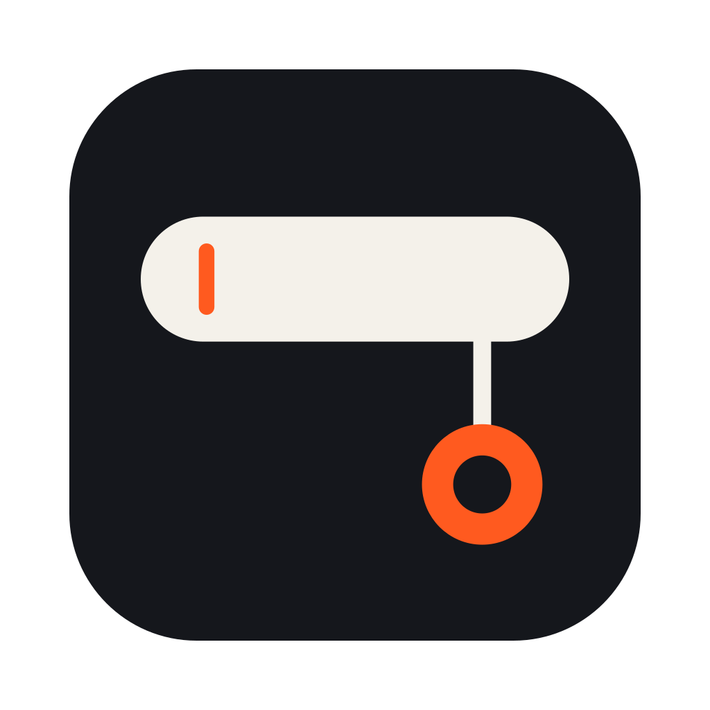

<div align="center">
    
    <h1>Ripcord</h1>
</div>

> A small, resident launcher for Apple silicon Macs, written in Swift and AppKit.

- Fuzzy-search apps by their localized or file name (`システム設定` and `System Settings` both work)
- ⌘Space shows the panel at once, on Liquid Glass; with nothing typed it lists running apps and
  Quicklinks
- Calculator: `1+2*3`, `(1.5+2)^2`, full-width input too; Return copies the result
- Quicklinks: `g swift testing` opens a search; with no match, the query goes to each Quicklink
- Favorites: ⇧⌘F on an app, command or Quicklink pins it to the top of the empty search, in
  your order (⌥⌘↑ and ⌥⌘↓ move it), as Raycast's Favorites do
- ⌘K lists the selected row's actions (Open Command ↵, Show in Finder ⇧⌘F, Copy Path or URL ⇧⌘C)
- Settings (⌘,): Launch at Login, the hotkey, the input source to type in and Quicklinks, kept
  in sync with the config file
- Settings has a page per extension (Applications, Quicklinks, Clipboard History, Snippets, System
  Actions, Window Management): give any app, Quicklink or command an alias, a hotkey that runs it
  from anywhere, or turn it off so it never shows up in search
- Clipboard History: copied text and images, including a copied image file such as a CleanShot X
  capture, with a preview and details of the selected one. Return pastes into the app you were in,
  ⇧⌘P pins an item to the top and ⌃X deletes it. Copies a password manager marks as concealed are
  never recorded, and switching the command off on its settings page stops recording
- Snippets: Create Snippet saves text with a name, keyword, icon and tags from the panel, and
  Search Snippets pastes it into the app you were in. `{clipboard}`, `{date}`, `{time}`,
  `{datetime}`, `{day}` and `{uuid}` are filled in, and `{cursor}` is where the caret lands.
  ⇧⌘C copies, ⌘E edits, ⌘D duplicates and ⌃X deletes; the tag menu filters the list. Export
  Snippets and Import Snippets read and write the JSON Raycast uses
- System Actions: lock the screen, log out, restart, shut down, sleep, control music and volume,
  hide, unhide or quit apps, restart the frontmost app, open or empty the Trash, eject disks, show
  the desktop, and toggle Dark Mode or Finder's hidden files. Ones that lose work ask first
- Git Repositories: Search Repositories lists the repositories in the folders you pick (`~/dev`
  and the like) and opens one in the app you assign to ↵, ⌘↵, ⌥↵, ⌃↵ or ⇧↵, an editor or a
  terminal; ⌘K adds Open on GitHub, Show in Finder and Copy Path
- Coffee: Caffeinate keeps the Mac and its display awake until Decaffeinate; type a time after
  it, as in `caffeinate 1h 30m`, to stop on its own. A cup with the time left shows in the menu bar
- Sleep Timer: type a time after it, as in `sleep timer 30m`, then pick Sleep or Turn Off Display;
  a moon with the time left shows in the menu bar until it fires or Stop Sleep Timer
- Color Picker: Pick Color copies a color from anywhere on screen in the format set on its
  settings page (HEX, RGB, HSL, SwiftUI or NSColor); Color History lists the colors picked, to copy
  in any format
- Clean Keyboard: turns every key off, media keys included, for 15 seconds to 5 minutes so the
  keyboard can be wiped, with the time left over the screen; ⌃⌥⌘↩ turns it back on early
- Bookmarks: Search Bookmarks lists the Markdown links in `~/.config/ripcord/bookmarks.md`
  (`- [Title](URL) - description`) under their `#` headings; Return opens one, and ⌘K copies its
  URL or title, edits it, moves it to another group or deletes it. Add Bookmark opens a form for a
  new one. Only the lines a change touches are rewritten; the rest stays as you wrote it
- Emoji & Symbols: Search Emoji & Symbols shows emoji and symbols (→ ° ⌘ and the like) in a grid by
  category, Frequently Used first; search in English or Japanese (`cat`, `ねこ`), Return pastes,
  ⌘↵ copies, and ⌘K picks a skin tone that's remembered
- HTTP Status Codes: look a code up by number or name, grouped by hundred; Return opens its MDN
  page and ⌘K copies the code or its name
- CleanShot X: Capture Area, Window, Fullscreen and Previous Area, Scrolling Capture, Record
  Screen, Capture Text, Self-Timer, Pin, Annotate, History and the rest of its URL scheme, listed
  when CleanShot X is installed
- Window Management: put the frontmost window in a half, quarter or third, maximize or center
  it, move it to the next or previous display, or restore where it was; give each a hotkey such
  as ⌃⌥← on its settings page
- Drag the panel anywhere; it remembers the spot, and Reset Ripcord Window Position brings it back

## Quick start

Free ⌘Space first: turn off Spotlight's shortcut and unassign it in any other launcher, or pick
another hotkey in Settings later.

1. Download `Ripcord-<version>.zip` from [Releases](https://github.com/meltin/ripcord/releases),
   unzip it and move `Ripcord.app` to `/Applications`.
2. Ripcord is ad-hoc signed and not notarized, so macOS blocks the first launch. Run
   `xattr -dr com.apple.quarantine /Applications/Ripcord.app`, or Control-click the app and choose
   Open.

Requires macOS 26 or later on Apple silicon.

### With Nix

```sh
nix profile add github:meltin/ripcord
# or try it without installing
nix build github:meltin/ripcord && open result/Applications/Ripcord.app
```

The flake builds with the host's Xcode 26 or later, because SwiftUI's `@State` is a macro whose
plugin ships only with Xcode and nixpkgs' Swift can't expand it. The build therefore runs outside
the Nix sandbox, which macOS's default `sandbox = false` or `relaxed` allows.

## Build from source

Requires Xcode 26 or later.

```sh
scripts/build-app.sh
open build/Ripcord.app
swift test
```

## Permissions

Pasting from Clipboard History or Search Snippets presses ⌘V for you, which needs Ripcord to
be allowed under System Settings › Privacy & Security › Accessibility; Ripcord asks once per
launch, on the first paste. Until then, Return only copies the item and beeps.

macOS ties the permission to how the app is signed. A build signed ad hoc, as one made without
the certificate below is, counts as a new app each time, so after an update remove Ripcord from
that list and add it again, or run `tccutil reset Accessibility io.github.meltin.ripcord`. To
build from source and keep the permission across rebuilds, create a signing certificate once:

```sh
scripts/create-signing-certificate.sh
```

It adds a self-signed certificate to your login keychain and asks for your password once, to trust
it for code signing. `scripts/build-app.sh` signs with it from then on. Once after creating it,
remove Ripcord from the Accessibility list (or run the `tccutil reset` command above) and grant it
to the next build; later builds keep it.

System Actions use Accessibility for the music and volume keys too, as Window Management does to
move windows. Empty Trash, Toggle System Appearance and Log Out, Restart and Shut Down ask macOS
to let Ripcord control Finder, System Events and the login window; allow it in the prompt, or
later under System Settings › Privacy & Security › Automation.

## Configuration

`~/.config/ripcord/config.json` is created on first launch and re-read every time the panel or
the settings window opens. The settings window writes every change back to it.

```json
{
  "hotkey": "cmd+space",
  "launchAtLogin": false,
  "inputSource": "com.apple.keylayout.ABC",
  "repositories": {
    "folders": ["~/dev"], "depth": 3,
    "openWith": { "return": "/Applications/Visual Studio Code.app", "cmd": "/Applications/Ghostty.app" }
  },
  "colorFormat": "hex",
  "snippets": [
    { "name": "Address", "keyword": "addr", "text": "1 Infinite Loop\nCupertino", "icon": "house",
      "tags": ["home"] }
  ],
  "quicklinks": [
    { "name": "Google Search", "keyword": "g", "url": "https://www.google.com/search?q={query}" }
  ],
  "items": {
    "com.1password.1password": { "alias": "pass" },
    "com.apple.Safari": { "hotkey": "ctrl+option+s" },
    "command:quit": { "disabled": true }
  }
}
```

`hotkey` is `cmd`, `option` or `ctrl` (plus `shift` if you like), then `space`, `return`, an
arrow (`left`, `right`, `up`, `down`), a letter or a digit.
Clipboard History keeps its last 300 unpinned items (plus every pinned one) in
`~/Library/Application Support/Ripcord/Clipboard`, as plain text and image files; an image over
32 MB or a text over 1 MB isn't kept. Delete the folder to clear it.

`items` holds the aliases, hotkeys and on/off switches set on the settings pages, for apps (by
bundle ID) and Ripcord's commands; a Quicklink keeps its own `hotkey` and `disabled`, and its
`keyword` is its alias.

`inputSource` is the keyboard input source the panel switches to while it's open, so a Japanese
input method left on doesn't turn the query into kana; the previous one comes back when it closes.
Leave it out to keep whatever is on. Pick it under Settings > General.

## Roadmap

Planned work lives in [Issues](https://github.com/meltin/ripcord/issues): clipboard history,
snippets, window management, an emoji picker, notes, local Git repositories, Markdown bookmarks,
CleanShot X commands and more small tools that replace Raycast extensions.

## License

Ripcord is licensed under [MIT](./LICENSE).

The GitHub icon in the panel's actions comes from [it-icons](https://github.com/ouka-lab/it-icons), under
[MIT](./Resources/ThirdParty/GitHub-LICENSE.txt).
The emoji names come from Unicode's [CLDR](https://github.com/unicode-org/cldr-json) and
[emoji-test.txt](https://unicode.org/Public/emoji/latest/emoji-test.txt), under the
[Unicode License](./Resources/ThirdParty/Unicode-LICENSE.txt).
The other icons are [Tabler Icons](https://github.com/tabler/tabler-icons), under
[MIT](./Resources/ThirdParty/Tabler-LICENSE.txt).
